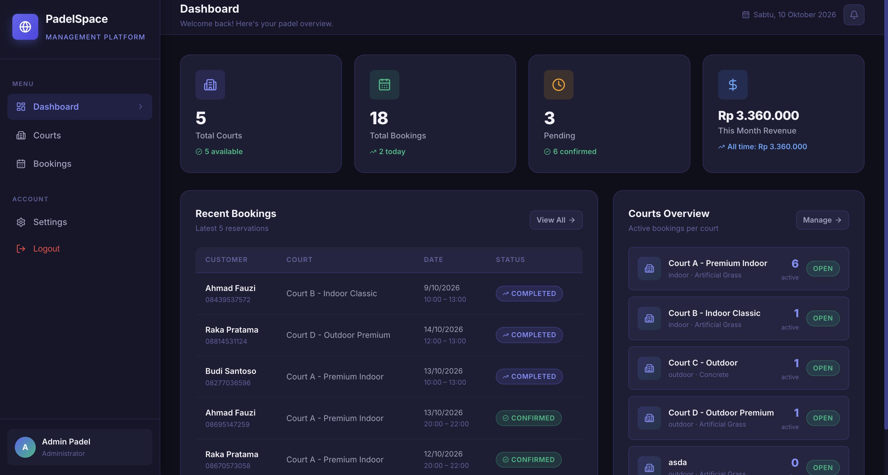
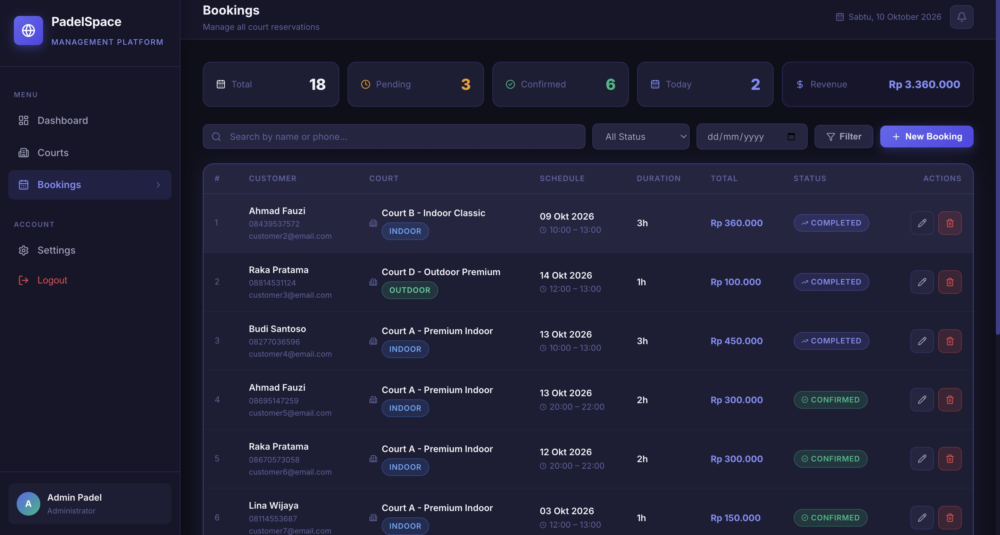
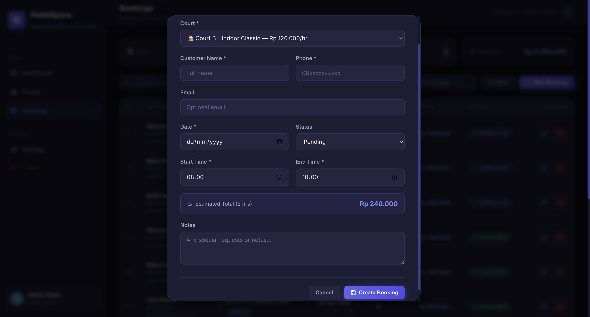
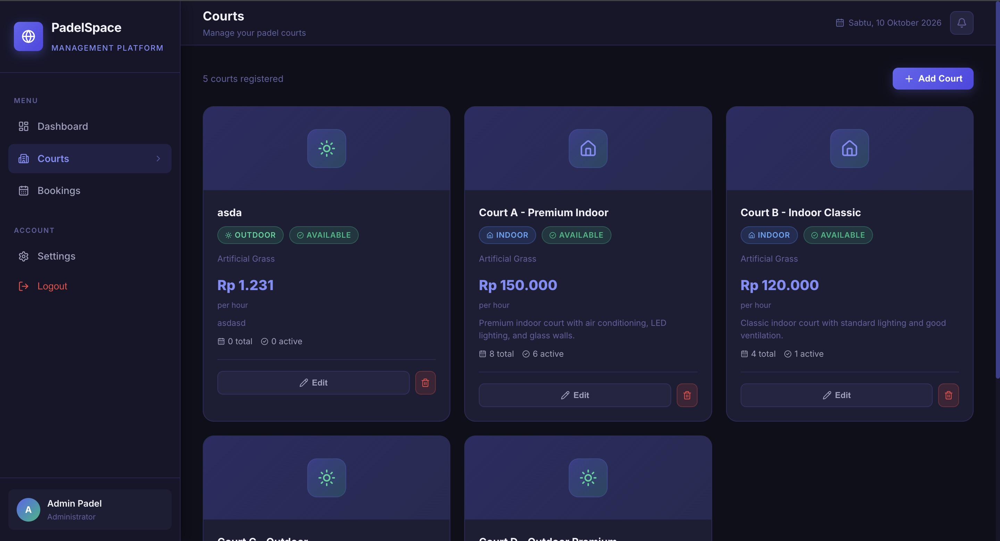
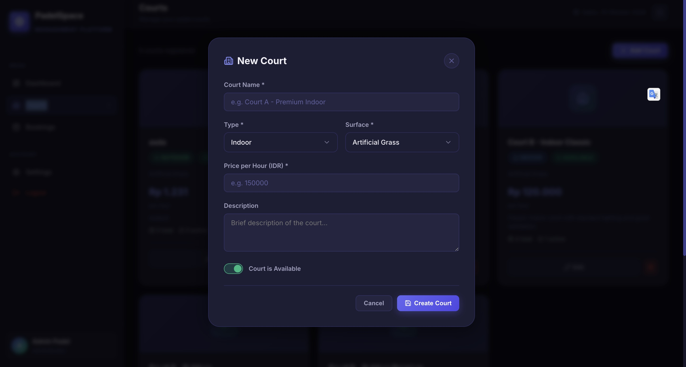
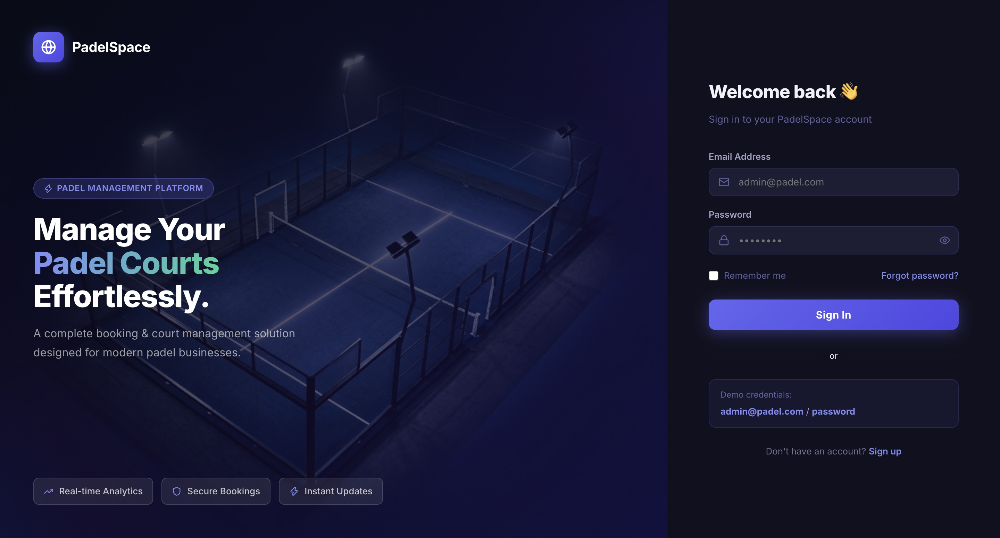
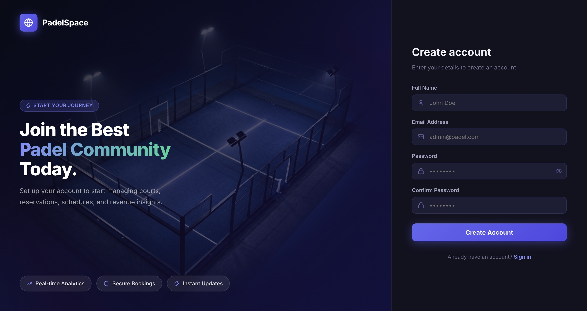

# 🎾 PadelSpace - Padel Court & Booking Management Platform

PadelSpace adalah platform manajemen fasilitas olahraga Padel modern berbasis web yang dibangun dengan arsitektur **Laravel 11 + Inertia.js + React**. Platform ini dirancang khusus untuk pemilik dan operator lapangan padel dalam mengelola inventaris lapangan, reservasi, jadwal, hingga analisis pendapatan secara real-time dengan tampilan dark mode premium.

---

## 📸 Preview Aplikasi

Berikut adalah dokumentasi tampilan antarmuka (UI) dari platform PadelSpace:

### 1. Dashboard Overview
Tinjauan operasional, ringkasan metrik performa (Total Courts, Total Bookings, Status, Estimasi Revenue), serta aktivitas reservasi terbaru.


---

### 2. Bookings Management (CRUD & Filter)
Daftar seluruh reservasi lapangan dengan pencarian instan, filter status, indikator badge status, dan aksi edit/delete.


---

### 3. Modal Reservasi Baru (Custom Select & Form)
Form pembuatan reservasi interaktif dilengkapi komponen dropdown custom (`CustomSelect`) tanpa elemen select native browser.


---

### 4. Court Management (Katalog Lapangan)
Katalog seluruh lapangan padel beserta informasi tipe (*Indoor/Outdoor*), tipe permukaan, tarif per jam, serta status ketersediaan.


---

### 5. Tambah / Edit Lapangan
Modal form pembuatan dan pembaharuan data lapangan padel.


---

### 6. Halaman Login (Split-Screen Modern)
Halaman autentikasi dengan split layout fotografi lapangan padel dan form dark mode elegan.


---

### 7. Halaman Registrasi
Halaman pendaftaran pengguna baru dengan validasi dan desain serasi.


---

## ⚡ Panduan Cepat Menjalankan Aplikasi (Quick Start)

Ikuti langkah-langkah mudah berikut untuk menjalankan proyek di komputer lokal:

### 1. Prasyarat
- **PHP** >= 8.2
- **Composer**
- **Node.js** >= 18 & **NPM**

---

### 2. Instalasi & Setup (Hanya 3 Menit)

#### Langkah A: Clone & Masuk ke Folder Proyek
```bash
git clone <repository-url>
cd "Technical Test"
```

#### Langkah B: Install Dependensi PHP & JavaScript
```bash
composer install
npm install
```

#### Langkah C: Konfigurasi Environment
```bash
cp .env.example .env
php artisan key:generate
```

*(Opsional)* Jika menggunakan **SQLite** (bawaan default):
```bash
touch database/database.sqlite
```

#### Langkah D: Migrasi Database & Seeder Data Demo
Jalankan perintah ini untuk membuat tabel serta mengisi data awal (5 lapangan padel, 18 transaksi booking, dan 1 akun admin demo):
```bash
php artisan migrate:fresh --seed
```

---

### 3. Jalankan Aplikasi

Jalankan backend Laravel dan frontend Vite development server di dua jendela terminal terpisah:

**Terminal 1 (Backend Laravel):**
```bash
php artisan serve
```

**Terminal 2 (Frontend React Vite):**
```bash
npm run dev
```

Buka browser Anda di:
👉 **[http://127.0.0.1:8000](http://127.0.0.1:8000)**

---

## 🔑 Akun Demo (Credentials)

Gunakan akun administrator berikut untuk login ke dalam sistem:

| Field | Kredensial |
| :--- | :--- |
| **URL Login** | `http://127.0.0.1:8000/login` |
| **Email** | `admin@padel.com` |
| **Password** | `password` |

---

## 🛠️ Tech Stack & Arsitektur

- **Backend Framework**: [Laravel 11](https://laravel.com/)
- **Frontend SPA Adapter**: [Inertia.js v2](https://inertiajs.com/) (React)
- **UI & Templating**: [React 18](https://react.dev/)
- **Icon Library**: [Lucide React](https://lucide.dev/) (Icon modern standar industri, menggantikan emoji bawaan)
- **Styling**: Modern CSS Design System dengan Dark Theme Palette & Glassmorphism
- **Komponen Dropdown**: Custom UI `CustomSelect` (terinspirasi dari arsitektur ICASVE, tidak menggunakan tag select native OS)
- **Database**: SQLite / MySQL via Eloquent ORM
- **Build Tool**: [Vite](https://vitejs.dev/)

---

## 🚀 Fitur Unggulan

1. **Dashboard Analytics**:
   - Kartu statistik dinamis (Total Courts, Total Bookings, Pending, Confirmed, Total Revenue).
   - Ringkasan booking terdekat dengan status instan.
2. **Manajemen Lapangan (Courts CRUD)**:
   - Tambah, lihat, ubah, dan hapus lapangan.
   - Pilihan tipe: *Indoor* & *Outdoor*.
   - Pilihan surface: *Artificial Grass*, *Concrete*, *Clay*, *Hard Court*.
   - Toggle status ketersediaan lapangan secara dinamis.
3. **Manajemen Reservasi (Bookings CRUD)**:
   - Pencatatan reservasi lengkap (nama pelanggan, kontak, jadwal main, lapangan).
   - Perhitungan durasi jam dan total biaya sewa secara otomatis.
   - Update status reservasi (*Pending*, *Confirmed*, *Completed*, *Cancelled*).
   - Filter real-time berdasarkan status dan tanggal main.
4. **Custom Select Component (`CustomSelect`)**:
   - Komponen dropdown kustom dengan dukungan pencarian (`searchable`), sub-label, highlight aktif, dan animasi rotasi icon panah.
5. **Autentikasi & Profile Management**:
   - Split layout auth screen dengan visual padel.
   - Pengaturan profil, penggantian password, dan perlindungan penghapusan akun.

---

## 📦 Build untuk Produksi

Untuk menghasilkan bundle produksi yang telah dioptimasi:
```bash
npm run build
```

---

© 2026 PadelSpace Management Platform.
